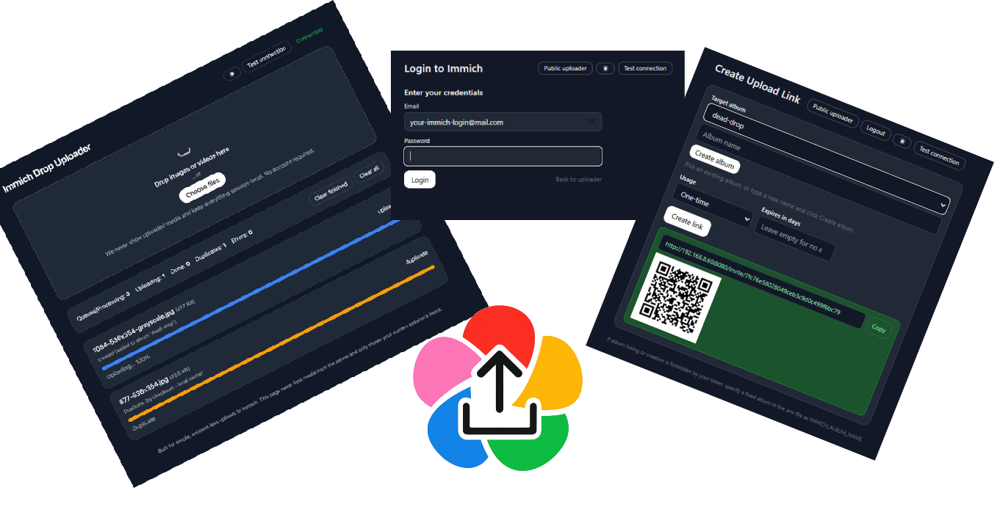

# Immich Drop Uploader

A small web app for collecting photos and videos into your **Immich** server.
Admins log in to create public invite links. Invite links are public by URL. A public uploader page at `/` is optional and off by default.



## Features

- **Invite links:** one-time or multi-use, optional expiry, optional password, optional album, QR code
- **Manage links:** search, sort, enable/disable, edit name and expiry, bulk enable/disable/delete, per-invite upload log
- **Immich Shared Links:** use a link created natively in Immich at `/invite/<key>`
- **Duplicate prevention:** local SHA-1 cache plus optional Immich bulk check
- **Progress queue:** WebSocket updates, retry for failed items
- **Chunked uploads (optional):** for proxies with request size limits
- **URL downloads:** fetch media from social platforms and upload it to Immich (web UI or API)
- **Platform cookies:** per-platform login cookies for content that needs authentication
- **iOS Shortcut:** share a URL from your iPhone to Immich ([setup guide](docs/ios-shortcuts.md))
- **Privacy:** never lists server media; the UI shows only the current session's uploads
- **Mobile and dark mode:** responsive UI, persistent theme

Release history is in [CHANGELOG.md](CHANGELOG.md).

---

## Table of contents

- [Quick start](#quick-start)
- [Configuration](#configuration)
- [Admin login and invites](#admin-login-and-invites)
- [Immich Shared Links](#immich-shared-links)
- [How it works](#how-it-works)
- [Chunked Uploads](#chunked-uploads)
- [URL Downloads](#url-downloads)
- [Platform Cookies](#platform-cookies)
- [iOS Shortcut](#ios-shortcut)
- [Security notes](#security-notes)
- [Usage flow](#usage-flow)
- [Architecture](#architecture)
- [Folder structure](#folder-structure)
- [Development](#development)
- [License](#license)

---

## Quick start

All settings can live in `docker-compose.yml`; no `.env` file is needed for deploys. The repo ships `docker-compose.yml.example` (it uses `build: .`). To use the published image instead:

```yaml
services:
  immich-drop:
    image: ttlequals0/immich-drop:latest
    pull_policy: always
    container_name: immich-drop
    restart: unless-stopped
    # Optional: run as the non-root appuser (uid/gid 1000) built into the image
    # user: "1000:1000"
    environment:
      # Immich connection (URL must include /api)
      IMMICH_BASE_URL: "https://immich.example.com/api"
      IMMICH_API_KEY: "${IMMICH_API_KEY}"

      # Optional behavior
      IMMICH_ALBUM_NAME: "dead-drop"
      PUBLIC_UPLOAD_PAGE_ENABLED: "false"
      PUBLIC_BASE_URL: "https://drop.example.com"

      # Chunked uploads (for proxy body limits)
      CHUNKED_UPLOADS_ENABLED: "false"
      CHUNK_SIZE_MB: "95"

      # Set this, or every restart logs everyone out
      SESSION_SECRET: "${SESSION_SECRET}"

      # Test connection button and banner
      TEST_CONNECTION_ENABLED: "true"
      TEST_CONNECTION_SHOW_HOSTNAME: "true"
    ports:
      - "8080:8080"
    # Persists state.db, chunks and cookies
    volumes:
      - immich_drop_data:/data

volumes:
  immich_drop_data:
```

```bash
docker compose pull
docker compose up -d
```

Image notes:

- Base `python:3.14-alpine`, with static `ffmpeg`/`ffprobe` from `mwader/static-ffmpeg:7.1`. pip is removed after install and there is no compiler in the image.
- `HEALTHCHECK` calls `http://127.0.0.1:$PORT/api/config`, because `/` redirects to `/login` when the public page is off.
- The image creates `appuser` (uid/gid 1000) and chowns `/data`, but starts as root by default. Add `user: "1000:1000"` to the service to switch. A bind-mounted `/data` must be writable by uid 1000; named volumes inherit ownership from the image.

---

## Configuration

All variables are read once at startup. Restart the container after changing any of them.

### Immich and app

| Variable | Default | Meaning |
|----------|---------|---------|
| `IMMICH_BASE_URL` | `http://127.0.0.1:2283/api` | Immich API URL. Must include `/api`. |
| `IMMICH_API_KEY` | empty | Used for uploads, duplicate checks, and invites that have no user token. |
| `IMMICH_ALBUM_NAME` | empty | Default album. Created automatically if missing. |
| `PUBLIC_UPLOAD_PAGE_ENABLED` | `false` | When `false`, `/` redirects to `/login`. |
| `PUBLIC_BASE_URL` | empty | Used to build absolute invite links. |
| `STATE_DB` | `/data/state.db` | SQLite file for the dedupe cache, invites, and cookies. |
| `SESSION_SECRET` | random per start | Session signing key. If unset, every restart logs everyone out. Set it. |
| `LOG_LEVEL` | `INFO` | Log level. |
| `HOST` | `0.0.0.0` | Bind address (`main.py`). |
| `PORT` | `8080` | Bind port (`main.py`). Also used by the healthcheck. |
| `TRUSTED_PROXY` | unset | IP, CIDR, comma list, or `*`. When set, uvicorn runs with `proxy_headers=True` and `forwarded_allow_ips=<value>` so client IPs behind a reverse proxy are recorded correctly. Unset means forwarded headers are ignored. |

`IMMICH_API_KEY` scopes:

| Use | Scopes |
|-----|--------|
| Uploads and duplicate checks | `asset.upload`, `asset.read` |
| Albums | `album.read`, `album.create`, `albumAsset.create` |
| API-key login (see below) | `user.read` |

### Uploads

| Variable | Default | Meaning |
|----------|---------|---------|
| `CHUNKED_UPLOADS_ENABLED` | `false` | When `false`, the chunk endpoints return 403 `chunked_uploads_disabled`. |
| `CHUNK_SIZE_MB` | `95` | Chunk size in MB. Fractions are allowed, e.g. `0.9` for nginx's default 1 MB body limit. |
| `CHUNK_DIR` | `/data/chunks` | Chunk staging directory. Abandoned chunk dirs are swept after 6 hours. |

### URL downloads

| Variable | Default | Meaning |
|----------|---------|---------|
| `SOCIAL_MEDIA_UPLOADS_ENABLED` | `true` | When `false`, hides the URL-download UI. The API routes stay reachable; see `API_UPLOAD_REQUIRE_AUTH`. |
| `API_UPLOAD_REQUIRE_AUTH` | `false` | When `true`, `POST /api/upload/url`, `/upload/urls`, `/upload/batch`, `/upload/file` and `/upload/base64` require an admin session cookie or a valid `invite_token` (JSON field, or form field for multipart). The token may be a local invite token or an Immich Shared Link key. Each call counts as one use of the invite, a one-time invite is consumed by the first call, uploads go to the invite's album, and a password-protected invite only works from a browser session that has already entered the password. Default is open so existing iOS Shortcut setups keep working. |
| `GALLERY_DL_SLEEP_REQUEST` | `10-25` | Seconds between HTTP requests during extraction. |
| `GALLERY_DL_SLEEP` | `5-15` | Seconds before each file download. |
| `GALLERY_DL_TIMEOUT` | `300` | gallery-dl subprocess timeout in seconds. |
| `DOWNLOAD_CONCURRENCY` | `1` | Concurrent URL downloads in batch mode. |
| `INSTAGRAM_YTDLP_FALLBACK` | `false` | yt-dlp fallback for Instagram is blocked by default to reduce detection risk. |

### Test connection

| Variable | Default | Meaning |
|----------|---------|---------|
| `TEST_CONNECTION_ENABLED` | `true` | When `false`, `/api/ping` returns `{ok:false, disabled:true}` and the button is hidden. |
| `TEST_CONNECTION_SHOW_HOSTNAME` | `true` | When `false`, the Immich URL is omitted from the banner. |

---

## Admin login and invites

Log in at `/login` with your own Immich email and password. The app validates them against Immich `/auth/login` and keeps the Immich access token in your session. Nothing is stored server-side.

If your Immich server has password login disabled in favor of OIDC, leave the email blank and paste an Immich API key into the password field. The key is validated against `GET /users/me` and used as `x-api-key` for the session. It needs the `user.read` scope.

Invites are created, listed, and edited by the logged-in owner only.

| Endpoint | Method | Purpose |
|----------|--------|---------|
| `/api/invite/{token}` | GET | Public info for an invite |
| `/api/invite/{token}` | PATCH | Edit an invite |
| `/api/invites/bulk` | POST | Bulk enable/disable |
| `/api/invites/delete` | POST | Bulk delete |
| `/api/invite/{token}/uploads` | GET | Per-invite upload log |
| `/api/invite/{token}/auth` | POST | Password gate; unlock is stored in the visitor's session |
| `/api/qr?text=` | GET | QR code image |

---

## Immich Shared Links

You can hand out a link created directly in Immich and use it here for uploads, with no local invite record:

1. In Immich, open an album, then Share, then Create link.
2. Enable "Allow public user to upload". The link must be an album link, not an individual-asset link.
3. Optionally set a password and/or expiry in Immich.
4. Copy the key from the generated URL (`https://your-immich/share/<key>`) and open `https://your-drop-host/invite/<key>`.

This app stores nothing for these links. Name, password, expiry, and album are read live from Immich (`GET /shared-links/me`, `POST /shared-links/login`). Upload and album-add calls authenticate with the share key. `IMMICH_API_KEY` is still required for the duplicate check that runs before each upload.

For a password-protected link, the unlock token lives in the visitor's own session, so one visitor entering the password does not unlock the link for anyone else. Chunked uploads on a share key are validated before any bytes reach disk.

Pairs with [immich-public-proxy](https://github.com/alangrainger/immich-public-proxy), which covers read-only viewing of shares.

---

## How it works

1. **Queue:** files selected in the browser are queued; each gets a client-side ID.
2. **Sending to server:** the browser sends the file with XHR (`POST /api/upload`, multipart: `file`, `item_id`, `session_id`, and optional `last_modified`, `invite_token`, `fingerprint`). The UI shows "Sending to server N%".
3. **Checking:** the server computes SHA-1 and checks `state.db`. If seen, the item is marked duplicate. It then optionally asks Immich `/assets/bulk-upload-check`.
4. **Uploading:** multipart POST to `${IMMICH_BASE_URL}/assets`. Fields: `assetData`, `filename`, `fileCreatedAt`, `fileModifiedAt` (ISO-8601 with UTC offset), `isFavorite=false`, plus header `x-immich-checksum`. `deviceAssetId` and `deviceId` are no longer sent (Immich v3); they are kept only in the local dedupe cache.
5. **Album:** if an album is configured on the invite or via `IMMICH_ALBUM_NAME`, the asset is added to it (the album is created if missing).
6. **Progress:** the backend pushes per-item progress over WebSocket `/ws` to the same session.

The test connection button uses Immich `/server/ping` and `/server/version`.

---

## Chunked Uploads

- Enable with `CHUNKED_UPLOADS_ENABLED=true`.
- `CHUNK_SIZE_MB` sets the chunk size (default `95`, fractions allowed). The client uses chunked mode only for files larger than this.
- Endpoints: `POST /api/upload/chunk/init`, `POST /api/upload/chunk`, `POST /api/upload/chunk/complete`.
- Duplicate checks, album add, and per-item WebSocket progress behave the same as whole-file uploads.
- Chunk ids are validated against path traversal, and invite or share-key validity is checked before any bytes hit disk.

---

## URL Downloads

Upload media from a URL through the web UI or the API.

**Routing:**

- yt-dlp handles YouTube, TikTok, and Facebook.
- gallery-dl handles everything else.
- Direct image URLs are fetched separately, capped at 100 MB.
- `GET /api/supported-platforms` is advisory only. Any URL is attempted.

**Known platform keys:** tiktok, instagram, reddit, youtube, twitter, facebook, flickr, tumblr, imgur, artstation, deviantart, pixiv, danbooru, bluesky, pinterest.

**API:**

| Endpoint | Method | Purpose |
|----------|--------|---------|
| `/api/upload/url` | POST | Submit one URL; returns `job_id` immediately |
| `/api/upload/url/status/{job_id}` | GET | Poll a job. Jobs are in memory, expire after 10 minutes, and are lost on restart. `done` is the string `"0"`, `"1"` or `"2"` for iOS Shortcuts. |
| `/api/upload/urls` | POST | Several URLs (max 10) |
| `/api/upload/batch` | POST | Multipart files (max 50), optional `album_name` |
| `/api/upload/file` | POST | Single multipart file |
| `/api/upload/base64` | POST | JSON `{data, filename?, album_name?}`; a `data:` URL prefix is accepted |
| `/api/supported-platforms` | GET | Advisory platform list |

All upload endpoints accept an optional `invite_token`. It is required when `API_UPLOAD_REQUIRE_AUTH=true`, and then each call consumes one use of the invite and uploads land in the invite's album regardless of `album_name`.

---

## Platform Cookies

Some platforms need a logged-in session for certain content (Instagram Reels, private TikTok videos). Accepted platforms: instagram, tiktok, twitter, reddit, youtube, facebook, flickr, tumblr, imgur, pixiv, deviantart, pinterest, bluesky, danbooru.

**Setup:**

1. Log in and open the admin menu (`/menu`).
2. Find the "Platform Cookies" section and select a platform.
3. Paste your cookie string and click "Save Cookie".

**Getting a cookie string:**

1. Open the platform in your browser while logged in.
2. Open DevTools (F12), Network tab, refresh, and click any request to the platform.
3. Copy the full value of the `Cookie:` request header.

**API (login required; otherwise 401 `unauthorized`):**

| Endpoint | Method | Purpose |
|----------|--------|---------|
| `/api/cookies` | GET | List cookies. Values are masked to a 40-character preview. |
| `/api/cookies` | POST | Create or update a platform cookie |
| `/api/cookies/{platform}` | DELETE | Delete a platform cookie |

An unsupported platform returns 400 `unsupported_platform`.

Cookies are stored in the `platform_cookies` DB table and written as Netscape cookie files under `/data/cookies` (`./data/cookies` in dev). They are flagged stale after 7 days (not configurable).

---

## iOS Shortcut

Share a link from any app on your iPhone and upload it to Immich. The shortcut submits the URL, polls for completion, and shows a notification, so slow downloads do not hit the iOS HTTP timeout.

**[Setup guide and download](docs/ios-shortcuts.md)**

---

## Security notes

- The menu and invite management are behind login. Logout clears the session.
- Invite links are public by URL; share them only with intended recipients.
- `/` is disabled unless `PUBLIC_UPLOAD_PAGE_ENABLED=true`.
- The server `IMMICH_API_KEY` never reaches the browser. A key used for API-key login is kept in that user's own signed session cookie, the same way the Immich access token is.
- Set `SESSION_SECRET`. Run behind HTTPS with a reverse proxy.
- The app has no CORS allowlist setting of its own. Restrict origins at the proxy and set `TRUSTED_PROXY` so client IPs are recorded correctly.
- Upload and URL-download API routes are open by default. Set `API_UPLOAD_REQUIRE_AUTH=true` to require a login session or invite token. `SOCIAL_MEDIA_UPLOADS_ENABLED=false` only hides the UI.
- Existing hardening: SSRF validation on submitted URLs, path traversal guards for chunk ids and cookie files, no stack traces sent to clients, invite validation before any bytes hit disk.
- `TEST_CONNECTION_SHOW_HOSTNAME=false` hides the Immich hostname from users; `TEST_CONNECTION_ENABLED=false` removes the test connection button entirely.

---

## Usage flow

- Admin: log in, open the menu, create an invite (optionally one-time, expiry, album, password), share the link or QR code.
- Guest: open the invite link, drop files, watch progress and results.
- Optional: enable the public uploader and set `IMMICH_ALBUM_NAME` for a default landing page.

---

## Architecture

- **Frontend:** static HTML/JS with no build step. Drag and drop or "Choose files", queue UI with progress and status chips.
- **Backend:** FastAPI + Uvicorn.
  - Proxies uploads to Immich `/assets`.
  - Computes SHA-1 and checks a local SQLite cache (`state.db`).
  - Optional Immich dedupe via `/assets/bulk-upload-check`.
  - URL downloads use yt-dlp or gallery-dl (see [URL Downloads](#url-downloads)).
  - WebSocket `/ws` pushes per-item progress to the current browser session only.
- **Persistence:** SQLite (`state.db`) holds the dedupe cache, invites, and platform cookies across restarts.

Other routes: `/`, `/login`, `/menu` (redirects to `/login` without a session), `/invite/{token}`, `/logout`, `GET /api/config` (public page flag, chunk settings, version, social media flag, test connection flag), `POST /api/ping`, `POST /api/logout`, `GET/POST /api/albums` (login), `POST /api/album/reset`.

---

## Folder structure

```
immich-drop/
|- app/
|  |- __init__.py
|  |- app.py               # ASGI app (uvicorn entry: app.app:app)
|  |- api_routes.py        # URL download and upload extension endpoints
|  |- config.py            # Settings loader
|  |- cookie_manager.py    # Platform cookies, Netscape file conversion
|  |- db.py                # SQLite access
|  |- immich_client.py     # Immich API client
|  |- job_manager.py       # In-memory URL download jobs
|  |- url_downloader.py    # yt-dlp / gallery-dl extraction
|  |- utils.py
|- frontend/
|  |- index.html           # Public uploader (optional)
|  |- invite.html          # Invite upload page
|  |- login.html           # Admin login
|  |- menu.html            # Admin menu
|  |- app.js               # Uploader logic
|  |- header.js            # Shared header (theme, ping, banner)
|  |- menu.js              # Admin menu logic
|  |- url-uploader.js      # URL upload UI
|  |- styles.css
|  |- favicon.png
|- docs/
|  |- ios-shortcuts.md     # iOS Shortcut guide
|  |- Dead-Drop.shortcut
|  |- build-shortcut.py
|- main.py                 # Entrypoint (python main.py)
|- version.py
|- requirements.txt
|- Dockerfile
|- docker-compose.yml.example
|- .env.example
|- CHANGELOG.md
|- README.md
|- screenshot.png
```

---

## Development

Requirements:

- Python 3.14
- ffmpeg on PATH (yt-dlp needs it for merges)
- An Immich server and API key

```bash
pip install -r requirements.txt
cp .env.example .env
python main.py    # uvicorn with reload on HOST:PORT
```

Example dev `.env` (values match the defaults except where noted):

```ini
HOST=0.0.0.0
PORT=8080

# Immich connection (include /api)
IMMICH_BASE_URL=http://REPLACE_ME:2283/api
IMMICH_API_KEY=ADD-YOUR-API-KEY

# Public uploader page, disabled by default
PUBLIC_UPLOAD_PAGE_ENABLED=false

# Default album (created if needed)
IMMICH_ALBUM_NAME=dead-drop

# Local dedupe cache (dev path)
STATE_DB=./data/state.db

# Absolute invite links
#PUBLIC_BASE_URL=https://photos.example.com

SESSION_SECRET=SET-A-STRONG-RANDOM-VALUE
LOG_LEVEL=INFO

# Chunked uploads
CHUNKED_UPLOADS_ENABLED=false
CHUNK_SIZE_MB=95

# Hide the Immich hostname in the ping banner
TEST_CONNECTION_SHOW_HOSTNAME=false
```

`.env.example` in the repo lists all keys.

---

## License

MIT.
